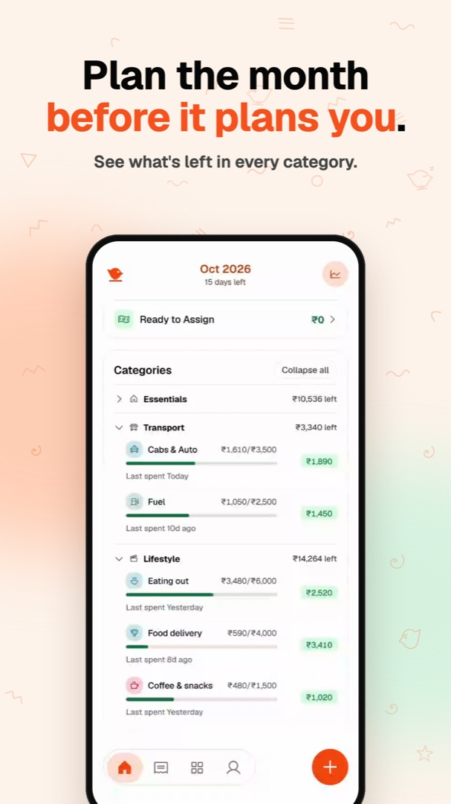
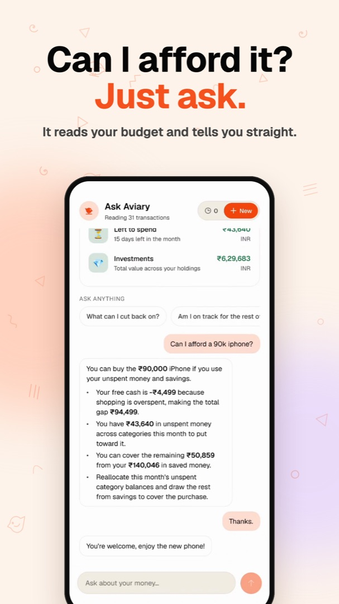
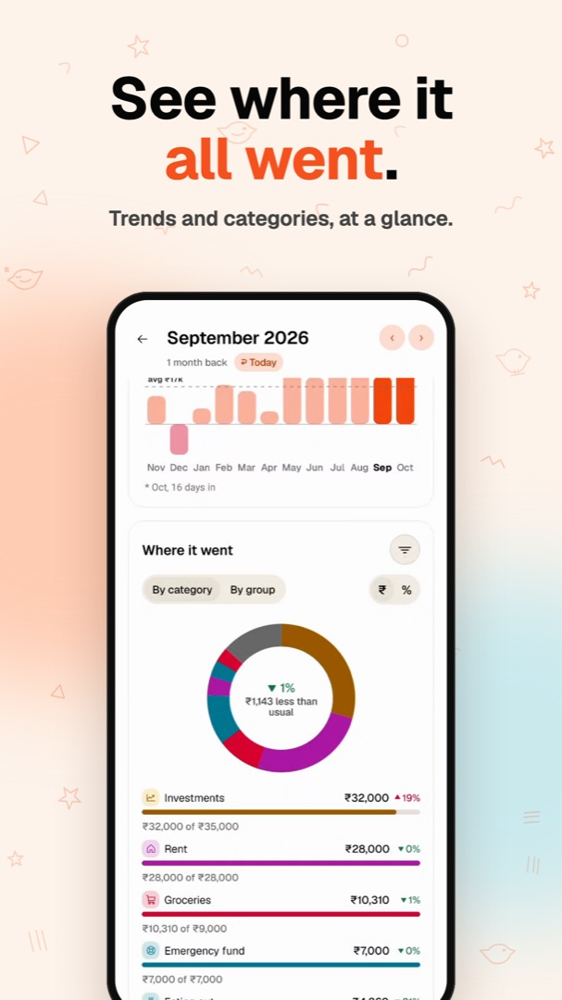

# Aviary

**It notices your 4pm chai and nudges you to log it.** The budgeting app you'll still open on day 4. Miss a day? Type what you remember and you're caught up. No bank link, no loans, no offers.

[Get it on Google Play](https://play.google.com/store/apps/details?id=com.sukrit04.envelope) · [Web app](https://useaviary.com) · [Mobile repo](https://github.com/Sukrittt/aviary-mobile)

<p align="center">
  
  
  
  
</p>
<p align="center">
  
  
  
</p>

## Why Aviary

Every budgeting app starts the same way, and so does the ending. You stop logging by day 4. That's not a willpower problem. Logging cost more than it gave back, so Aviary makes it cheap.

- **It learns your habits.** Log the same thing on the same weekday, around the same time, three times in eight weeks, and Aviary nudges you 15 minutes after with the details filled in. Tap Log on the notification and it's in.
- **Catch up in one line.** Missed yesterday? Type "auto 240, lunch 150, Friday dinner 900" into Ask Aviary. It splits that into separate spends, picks the categories, and you check them before they land.
- **One tap on a normal day.** A home-screen widget, a keypad where the category picks itself, receipt scanning that splits shared bills, recurring expenses that log themselves, and offline logs that sync later.
- **Noticing is the point.** There's no bank sync. Aviary keeps the one second where you notice a spend and takes away everything around it.
- **Every log is a little win.** A check, a buzz and a chime, then what's left in that category. Expense Wrapped turns your month into a recap with your spending personality and longest streak.
- **Give every rupee a job.** The envelope method YNAB made popular: Ready to Assign, categories, and moving money when you overspend. Rupees by default, or pick your own currency.
- **More in the nest.** Ask Aviary answers "can I afford it?" from your own budget, Insights shows where it all went, and every subscription gets a heads-up before it renews.

Free for 30 days, no card needed. Android and web today, with an iPhone waitlist on [useaviary.com](https://useaviary.com). No ads, and your data is never sold.

## About this repo

The web frontend and API for Aviary, alongside the Expo app in [`Sukrittt/aviary-mobile`](https://github.com/Sukrittt/aviary-mobile). A personal finance dashboard for envelope budgeting, expense tracking, subscriptions, and investments. Built with Next.js and MongoDB, with WorkOS AuthKit for sign-in.

## Highlights

- **Envelope budgeting** — assign a monthly budget per category, organize categories into groups, see Ready to Assign, move money between envelopes, and roll amounts over across months.
- **Transactions** — add entries inline, recategorize them, and click an envelope to filter the transaction log by that category.
- **Auto-categorization** — the API learns a keyword → category map from past expenses (`/api/category-map`) and suggests categories for new entries.
- **Spending insights** — daily/weekly/monthly trend charts, a heatmap, sparklines, and a subscription timeline.
- **Subscriptions** — track services and amounts, cancel/reactivate, and see next-due dates.
- **Investments** — holdings and net worth, market updates, contributions/withdrawals, and an event log.
- **AI (Ask Aviary)** — Gemini-powered chat about your spending (`/api/ai/chat`, streamed), daily brief cards (`/api/ai/brief`), and a cron transaction scan that flags anomalies and sends push notifications.
- **Push notifications** — Expo push tokens registered per device; weekly spend digest and AI scan alerts.
- **Wrapped recap** — `/api/wrapped` computes the year-in-review payload the mobile Wrapped screen renders.
- **Account & security** — email change with 6-digit verification, linked identities (Google/email), active-session list with remote revoke, delete account, data export (CSV/JSON).
- **Onboarding tour** — a 3-slide walkthrough shown once per account after first sign-in.
- **Theme** — light/dark, persisted per account.

## Stack

- [Next.js 15](https://nextjs.org/) (App Router), React 19, TypeScript
- [MongoDB](https://www.mongodb.com/) via the official `mongodb` driver (Atlas or local)
- [@workos-inc/authkit-nextjs](https://github.com/workos/authkit-nextjs) + `@workos-inc/node` for sessions and user management
- [@google/genai](https://github.com/googleapis/js-genai) (Gemini) for AI features
- [Phosphor](https://phosphoricons.com/) (`@phosphor-icons/react`) for icons

## How data is stored

Data lives in MongoDB. The API route handlers under `app/api/` read and write these collections:

| Domain | Collections |
| --- | --- |
| Expenses & budgeting | `expenses`, `budgets`, `categories`, `groups` |
| Subscriptions | `subscriptions` |
| Investments | `holdings`, `holding_events` |
| Accounts & devices | `users`, `push_tokens`, `notification_log` |

Every document carries a `user_id` (a WorkOS user id) — there are no separate `demo_*`
mirror collections; the demo account is just another `user_id` (`DEMO_USER_ID`).

The database is seeded from local CSV files (see [Data migration](#data-migration)). The real-data CSVs are **gitignored** — they hold personal financial data and are never committed; only the sample `demo/` CSVs ship with the repo.

## Authentication

Sign-in is WorkOS AuthKit, but never through WorkOS's hosted UI — Google goes straight
to Google's consent screen and email uses 6-digit magic-auth codes, both via
`/api/auth/*` (`app/(auth)/sign-in`, `/email`, `/code`). A first-time sign-in creates
the account; there is no separate signup step.

- `middleware.ts` gates every page except `/sign-in`, `/email`, `/code` behind a
  session cookie; signed-out visitors are redirected to `/sign-in`. `/api/*` is never
  gated by middleware — each route resolves its own auth via `lib/access.ts::getAuth`.
- New accounts land on `/onboarding` (a 3-slide tour) once, tracked via `onboardedAt`
  on the user's doc.
- `/api/*` requests without a valid session fall back to a read-only demo user
  (`DEMO_USER_ID`) — every non-GET from that user returns `403`. This is a backend
  fallback for API callers that bypass the browser (tests, curl); there is no "continue
  as guest" UI path in any page.
- `/account` (You), `/account/security`, `/account/data`, `/account/help` cover profile,
  sign-out-everywhere, delete account, data export (CSV/JSON), clear-transactions, and
  support links.

## API

Route handlers are the CSV-era `/api/*` endpoints, now backed by MongoDB. Each request
resolves its owning user id (real or demo) via `lib/access.ts::getAuth`.

| Endpoint | Methods | Purpose |
| --- | --- | --- |
| `/api/expenses` | GET, POST, PUT | Transaction log; PUT also recategorizes |
| `/api/budgets` | GET, POST, PUT, DELETE | Monthly envelope budgets |
| `/api/categories` | GET, POST, PUT, DELETE | Envelope categories |
| `/api/categories/move` | POST | Drag a category to an index |
| `/api/category-map` | GET | Keyword → category suggestions |
| `/api/category-map/suggest` | POST | LLM-assisted suggestion fallback (Gemini) |
| `/api/groups` | GET, POST, PUT, DELETE | Category groups |
| `/api/groups/move` | POST | Drag a group to an index |
| `/api/subscriptions` | GET, POST, PUT | Subscriptions |
| `/api/holdings` | GET, POST, PUT, DELETE | Investment holdings |
| `/api/holdings/action` | POST | Contribution / withdrawal |
| `/api/holding-events` | GET | Holding event log |
| `/api/user` | GET, PATCH, DELETE | Profile, preferences, onboarding flag; delete account |
| `/api/user/email` | POST | Start email change (sends 6-digit code) |
| `/api/user/email/resend`, `/verify` | POST | Resend / verify the change-email code |
| `/api/user/identities` | GET | Linked auth identities (Google, email) |
| `/api/user/sessions` | GET, DELETE | Active sessions; revoke all others |
| `/api/data/export` | GET | Export all of a user's data (`?format=csv\|json`) |
| `/api/data/summary` | GET | Transaction/envelope counts for the export screen |
| `/api/data/clear-transactions` | POST | Wipe transactions, keep envelopes |
| `/api/wrapped` | GET | Year-in-review recap payload (mobile Wrapped screen) |
| `/api/ai/brief` | POST | AI daily brief cards from recent spending |
| `/api/ai/chat` | POST | Ask Aviary chat (streamed, rate-limited) |
| `/api/notifications/register` | POST | Store an Expo push token for a device |
| `/api/notifications/run` | GET | Cron-only (`CRON_SECRET`); Smart Notifications — envelope thresholds, bill reminders, digest, AI coaching nudge |
| `/api/auth/google`, `/api/auth/magic-auth/*` | GET/POST | Sign-in |
| `/logout` | GET | Sign out (clears session, ends WorkOS session) |

## Routes

| Route | Page |
| --- | --- |
| `/` | Redirects to `/expense` |
| `/sign-in`, `/email`, `/code` | Sign-in flow |
| `/onboarding` | First-run tour |
| `/expense` | Budget dashboard |
| `/expense/transactions` | Transaction log |
| `/investments` | Investments / net worth |
| `/account`, `/account/security`, `/account/data`, `/account/help` | Profile, preferences, account & security, data export, help |

Envelopes guard against duplicate category/group names, and the default **Archived** group can't be deleted.

## Environment variables

| Variable | Purpose |
| --- | --- |
| `MONGODB_URI` | Required. MongoDB connection string (Atlas or local). |
| `WORKOS_CLIENT_ID` | WorkOS AuthKit client id. Use the same WorkOS environment locally and in production. |
| `WORKOS_API_KEY` | WorkOS API key. |
| `WORKOS_COOKIE_PASSWORD` | Encrypts the AuthKit session cookie. 32+ chars. |
| `NEXT_PUBLIC_WORKOS_REDIRECT_URI` | Callback URL, also registered in the WorkOS dashboard. |
| `DEMO_USER_ID` | Owner of the sample data served to unauthenticated API requests. |
| `CRON_SECRET` | Bearer token Vercel Cron sends when invoking `/api/notifications/run`. |
| `GEMINI_API_KEY` | LLM-assisted category suggestions and AI transaction scan. |

## Data migration

The database is seeded from local CSV files by a one-off script. This reads the real data in `productivity/` and `data/` (kept out of git) plus the committed sample data in `productivity/demo/` and `data/demo/`, and upserts each row into MongoDB:

```bash
npm run db:migrate   # requires MONGODB_URI in .env.local or the environment
```

Collections keyed by a natural field (`budgets`, `categories`, `groups`, `subscriptions`, `holdings`) upsert in place; append-only logs (`expenses`, `holding_events`) are cleared and re-inserted.

## Local development

```bash
cp .env.example .env.local   # set MONGODB_URI and the WORKOS_* vars
npm install
npm run db:migrate           # seed MongoDB from your local CSVs
npm run dev
```

## Checks

```bash
npm run lint
npm run build                # type-checks; lint is deferred (see eslint.config.mjs)
```

## Deploy

Deploy to Vercel. `vercel.json` pins the framework preset to `nextjs`, so the Next.js build output (`.next`) is used automatically.

- Set `MONGODB_URI` in the project's environment variables.
- Set the `WORKOS_*` vars and register the production callback URL in the WorkOS dashboard.

## Scripts

- `npm run db:migrate` — seed MongoDB from local CSVs (`scripts/migrate-to-mongo.mjs`)
- `npm run sync:expenses` — sync the expense CSVs (`scripts/sync_expenses.mjs`)

## License

Copyright (c) 2026 Sukrit Saha. Licensed under the [GNU Affero General Public License v3.0](LICENSE). If you run a modified version of Aviary as a service, you must publish your source code under the same license.
